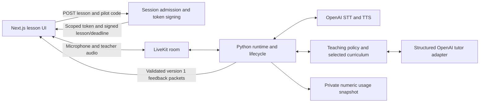

# Eng Teacher: project status, repository guide and continuation tasks

Updated **17 November 2026 (Asia/Calcutta)**. Source inspected:
[`d25992f`](https://github.com/Planeshiffhter/eng-teacher/commit/d25992f2f521478a9aa935d7967d11ad37bdc4bf).
This is the current starting document for another coding tool or contributor.
It records implemented behavior, evidence limits, remaining work and the review
process. Recheck current `main` and the code before acting on this snapshot.

## 1. Start here

1. Read this file, [AGENTS.md](AGENTS.md),
   [current implementation](docs/development/IMPLEMENTATION_STATUS.md), and
   [setup and tests](docs/development/DEVELOPMENT.md).
2. Inspect Git status and current `main`. Preserve and push reviewed existing
   work before a new task: maintainer to `main`, PR contributor to their task
   branch. Never commit credentials or generated dependencies.
3. Choose one task ID from section 6, inspect its existing implementation, and
   deliver one complete, tested slice. Do not rebuild working foundations.
4. Use the file map below and the
   [file guide and historical appendix](docs/development/REPOSITORY_FILE_GUIDE.md).
5. Follow section 8 when handing work back or submitting a PR. Update evidence
   and task status with the actual commit, checks and limitations.

The maintaining Codex agent continues to push its work directly to `main`.
The owner now also authorizes **other tools/contributors to submit focused PRs**
for review. This exception supersedes older blanket no-PR instructions for those
contributors. A PR is a proposal; this request does not authorize automatic merges.

Older checklists and build prompts contain dated “next task” instructions for
retry/help handling and usage counters that are already implemented. This file
and the current source take precedence for continuation; preserve older reports
as historical evidence. In particular, do not repeat the old Hindi-explanation
bug fix, recreate Everyday English, or add a second usage-counter subsystem.

## 2. Main goal and product direction

Build an original, commercially viable **AI English-speaking companion**. A
learner should speak naturally, receive patient replies and a useful English
improvement, ask for help, retry, and continue a meaningful conversation. The AI
must identify itself as AI. Preserve the learner's meaning and confidence rather
than manufacture mistakes or demand a particular accent.

The first release to prove is a **ten-minute Hindi–English mobile-web lesson**:
mock interview or Everyday English, real microphone and spoken teacher replies,
one useful correction at a time, original/suggested text kept separate, Hindi
help, interruption, captions, retry and recap. The audio-only implementation
exists. A successful real-provider lesson is still an open acceptance gate.

The larger goal includes Bengali-English help after fluent-speaker validation,
an optional licensed female/male animated teacher, original goal-based lessons,
learner-controlled progress and spaced review, calibrated audio pronunciation
coaching, secure accounts, sustainable operations and eventual model independence.
These are **future capabilities**, with dependencies detailed below.

The product should measure meaning preservation, false corrections, successful
independent reuse, call reliability, latency and actual cost. Competitors are
feature benchmarks, not sources of proprietary characters, branding or curriculum.
There is no claim of guaranteed fluency, universal language support, trained
models or achieved commercial quality.

Read the full [project idea](docs/product/PROJECT_IDEA.txt),
[vision](docs/product/PRODUCT_VISION.md), and
[MVP acceptance](docs/product/MVP_AND_ACCEPTANCE.md) for the intended experience.

## 3. What is implemented, and what that evidence means

**Implemented / offline-tested** means code exists and relevant local automated
checks passed. **Live-unvalidated** means the external provider/device/teaching
gate has not passed. **Planned** means it remains a future task. **Reference-only**
means preserved third-party code or isolated research, not a feature in this app.

| Capability | Current implementation | Remaining work |
| --- | --- | --- |
| Two guided lesson choices | Mock interview and original Everyday English; two allowlisted IDs, seven worker questions each, selected greeting and continuation | More reviewed exercises and learning outcomes; T11/T16 |
| Lesson selection end to end | Web choice → server-validated/signed `lesson_id` → immutable worker curriculum; omitted ID keeps interview compatibility | Future languages/preferences need the same validated contract; T08/T12 |
| Responsive call UI | Lesson/pilot form, joining states, mic mute/end, audio-enable recovery, teacher status, captions and timer | Connected-device accessibility and failure coverage; T02/T06/T12 |
| Voice pipeline | LiveKit browser and Python `AgentSession`, CPU Silero VAD, OpenAI recognition/model/speech, configured interruption support | Real-provider and physical-device acceptance; T01/T02 |
| Teaching policy | One pending correction; original recognized text, suggestion and explanation stay separate; clarification and conservative name/number/negation guards | Human-reviewed teaching accuracy; T03/T04 |
| Assistance and retry | Hindi/English explanation, example, Hindi translation, repeat, another try and skip; supported commands preserve pending practice; exact and semantic text retry handling | Broader natural/Hinglish requests and observed failures; T04/T06 |
| Failure recovery | Generic recoverable model/help errors keep lesson state; fatal paths end cleanly; startup/cancellation/resource-close regressions covered | Actual provider/network failures and connected-room UI cases; T02/T06 |
| Session admission | Server-only token signing; pilot code, origin, JSON/body/lesson checks; random room/learner IDs; microphone-only publishing, named worker, two-participant room | Individual accounts, distributed quotas, abuse and spend controls; T13 |
| Fixed lesson limit | Signed ten-minute deadline enforced in web and worker; reconnect cannot extend it; disconnect/deadline cleanup attempts room deletion | Confirm actual media stops and provider charging behavior; T02/T05 |
| Captions, feedback and recap | Recognized transcript and correction cards, assistance/error messages, bounded feedback and page-memory recap | Opt-in saved progress/history; T14/T15 |
| Private usage accounting | Numeric model requests/responses/errors/reported tokens, missing-unit distinction, reported STT audio seconds and synthesized characters; bounded in-memory snapshots | Total billing, retries not exposed by SDK, real p50/p90 latency and per-lesson economics; T05 |
| Privacy defaults | No app database or intentional recording; worker disables recording and cloud transcript/trace uploads; private error handling | Provider terms/retention review and explicit controls before persistence; T09/T14 |
| Reusable development environment | Frozen npm/uv installation, Node 24/Python 3.12 workflow, writable cloud caches, production build and browser runner | Secure live configuration and independent production deployment; T01/T18 |
| Bengali / additional languages | Product priority and research only; no implemented language-preference contract or verified Bengali workflow | Trial first, then scoped implementation; T07/T08 |
| Animated teacher | Preserved SDK, model/assets and isolated graphics/audio evidence only | Licensing decision and narrow app integration; T09/T10 |
| Pronunciation scoring | None; text retry checks are not acoustic assessment | Licensed audio assessor and human calibration; T17 |
| Accounts, saved learning, payments | None; shared pilot gate and memory-only recap are the current boundary | T13–T16/T20 |
| Native Android / own fine-tuned model | None; browser testing and hosted adapters are the existing approach | Evidence-dependent later work; T21–T23 |

Important limits: “original transcript” is what STT recognized, not guaranteed
ground truth. Whisper is adapted to turn-based recognition; word-by-word live
caption quality is not established. Meaning guards and model prompts are not a
guarantee of correctness. Text similarity or a successful retry is never a
pronunciation, accent or fluency score. External providers still process audio
and text under their own terms even though this app does not record sessions.

### Last verified checks

The last active cloud run, recorded in
[DEVELOPMENT.md](docs/development/DEVELOPMENT.md#managed-cloud-environment), passed
**24 web + 136 worker + 8 maintenance + 8 desktop/mobile browser tests = 176**,
plus production build, TypeScript and Python lint/format. The application code
in the inspected `d25992f` snapshot matches that tested code. This documentation
does not claim another live-provider or remote GitHub Actions run.

Browser tests use a synthetic microphone, missing configuration and failed-room
recovery. Worker tests use fake provider/room inputs, including actual installed
SDK scheduling with synthetic silence. These validate engineering contracts,
not a completed learner-to-provider call.

Earlier isolated checks of 470 Cadence and 16 avatar cases and avatar browser
smoke are recorded in [MODULE_VALIDATION.md](docs/development/MODULE_VALIDATION.md).
They are historical reference evidence and are not 486 additional app features
or tests rerun by this handoff task. Known live blockers are listed in T01/T02.

## 4. Architecture and folder responsibilities



This is the implemented integration path; its live behavior remains to be
accepted. There is currently no database, avatar renderer, auth service, payment
service, training pipeline or native application in the active product.

| Folder | Responsibility and next owner |
| --- | --- |
| Repository root | Navigation, owner rules, npm commands, runtime pins and runner configuration |
| `.github/` and `.github/workflows/` | PR evidence template and active CI; not provider credentials |
| `apps/` → `apps/web/` | The sole active npm application: Next.js, React and LiveKit browser client |
| `apps/web/app/` → `api/session/` | Thin framework entrypoints, layout/styles and the session route |
| `apps/web/features/lesson/` → `components/`, `tests/` | Learner-facing call state, public lesson choices, room event contract and matching tests |
| `apps/web/features/session/` → `server/`, `tests/` | Server admission/signing policy and tests; client must not import provider secrets |
| `services/` → `voice-agent/` | The sole active worker: Python packaging, configuration and source/tests |
| `src/eng_teacher/teaching/` | Provider-independent curriculum, help/intent recognition, correction and retry state |
| `src/eng_teacher/providers/` | External recognition, model and speech adapter boundaries; OpenAI only today |
| `src/eng_teacher/runtime/` | LiveKit audio, packets, deadlines, resource cleanup and numeric usage |
| `services/voice-agent/tests/teaching/`, `tests/runtime/` | Fixtures and regression tests matching those service owners |
| Root `tests/browser/`, `tests/contracts/`, `tests/maintenance/` | Cross-component browser cases, shared language-runtime contracts, and maintenance CLI fixtures |
| `scripts/maintenance/` | Explicit static inventory/security utilities; never auto-run archived applications |
| `docs/product/`, `architecture/`, `development/` | Product requirements, runtime decisions, setup, actual feature status and validation evidence |
| `docs/research/`, `legal/`, `continuity/` | Reuse studies, obligations/notices, and dated history for future sessions |
| `AnalyseFuture/` | Original ZIPs, source recovery details, superseded implementations and recovery evidence |

The [file guide](docs/development/REPOSITORY_FILE_GUIDE.md) links active collections
and the dated per-file appendix.
Ignored `.git/`, `node_modules/`, `.next/`, `.venv/`, `__pycache__/`, caches,
`*.egg-info`, test outputs and `.env.local` are local/generated state. They are
not authored features, not part of the tracked-file catalog, and must not be
added to commits to preserve a workspace.

## 5. File-by-file guide

The tables here explain every active source/config/test file and the document
collections needed to continue. Use the [file guide](docs/development/REPOSITORY_FILE_GUIDE.md)
to locate the immutable 1,603-file inventory from the earlier recovery revision.

### Root, CI and verification tools

| File | What it does |
| --- | --- |
| [README.md](README.md) | GitHub landing page, overview and links to current guides |
| [PROJECT_HANDOFF.md](PROJECT_HANDOFF.md) | This current status, task backlog and collaboration contract |
| [PROJECT_STRUCTURE.md](PROJECT_STRUCTURE.md) | Current ownership/layout and preserved organization history |
| [AGENTS.md](AGENTS.md) | Owner instructions, safe checkpoints, scoped execution and contributor workflow |
| [package.json](package.json) | Root commands, web-only npm workspace, Node 24 requirement, Playwright and PostCSS override |
| [package-lock.json](package-lock.json) | Exact npm dependency versions and integrity; preserve frozen installs |
| [.nvmrc](.nvmrc) | Node major 24 |
| [.gitignore](.gitignore) | Keeps dependencies, builds, caches, logs, test output and local secrets untracked |
| [pytest.ini](pytest.ini) | Default discovery for active worker and maintenance tests; excludes archives |
| [playwright.config.ts](playwright.config.ts) | Desktop Chrome/Pixel 7 projects, synthetic mic, one worker, system Chromium selection and isolated production server on port 3100 |
| [.github/workflows/checks.yml](.github/workflows/checks.yml) | PR/main-push frozen installs, unit/service/maintenance tests, lint/format, build/typecheck and browser checks; no live-provider test |
| [.github/pull_request_template.md](.github/pull_request_template.md) | Task scope, evidence and live-limit reporting required from proposing tools |
| [repository_inventory.py](scripts/maintenance/repository_inventory.py) | Statically classifies tracked files, purposes/imports, hashes and duplicates; does not execute inspected source |
| [security_history_scan.py](scripts/maintenance/security_history_scan.py) | Scans reachable Git blobs, tracked files and ZIP members for candidate patterns without printing matched values; not a complete security audit |
| [test_repository_tools.py](tests/maintenance/test_repository_tools.py) | Eight CLI tests using disposable Git fixtures, including history/ZIP handling and value non-disclosure |
| [lesson-catalog.json](tests/contracts/lesson-catalog.json) | Shared TS/Python lesson IDs/default to prevent catalog drift |
| [lesson.spec.ts](tests/browser/lesson.spec.ts) | Four offline entry/failure scenarios on each desktop/mobile project, eight total; no successful live lesson |

### Web application: `apps/web/`

| File under `apps/web/` | Implemented responsibility |
| --- | --- |
| [app/page.tsx](apps/web/app/page.tsx) | Thin homepage rendering the lesson feature |
| [app/layout.tsx](apps/web/app/layout.tsx) | HTML/metadata/global CSS shell; interview-specific metadata can be polished for both modes in T12 |
| [app/globals.css](apps/web/app/globals.css) | Responsive call/feedback/picker styling, focus states and reduced-motion support |
| [app/api/session/route.ts](apps/web/app/api/session/route.ts) | Dynamic server POST route, request budget, no-store responses and safe typed/generic errors |
| [features/lesson/catalog.ts](apps/web/features/lesson/catalog.ts) | Two safe public lesson IDs, labels and display descriptions; no worker prompts |
| [features/lesson/components/tutor-app.tsx](apps/web/features/lesson/components/tutor-app.tsx) | Form/admission/join state, real SDK room/mic/audio controls, captions, timer, correction/help/error cards and memory-only recap |
| [features/lesson/tutor-events.ts](apps/web/features/lesson/tutor-events.ts) | Version 1 packet validation, text/payload bounds, feedback deduplication/retention and deadline that can only shorten |
| [features/lesson/tests/catalog.test.ts](apps/web/features/lesson/tests/catalog.test.ts) | Shared catalog/default contract and rejection of unsupported/prototype values |
| [features/lesson/tests/tutor-events.test.ts](apps/web/features/lesson/tests/tutor-events.test.ts) | Original/correction separation, malformed events, help/errors/deadlines, deduplication and bounded feedback |
| [features/session/server/session.ts](apps/web/features/session/server/session.ts) | Strong config/pilot/origin/JSON/body/lesson checks, random room/learner scope, signed JWT and named dispatch; process-local 30-start/minute budget |
| [features/session/tests/session.test.ts](apps/web/features/session/tests/session.test.ts) | Admission/grant/deadline policy with real local signing/verification and test-only keys |
| [features/session/tests/route.test.ts](apps/web/features/session/tests/route.test.ts) | Actual handler responses, typed errors, request-budget retry hints and safe configuration failures |
| [package.json](apps/web/package.json) | Pinned Next 15, React 19 and LiveKit dependencies plus dev/build/start/typecheck/Vitest commands |
| [tsconfig.json](apps/web/tsconfig.json) | Strict app-local TypeScript, aliases and generated Next route types |
| [next.config.ts](apps/web/next.config.ts) | Next configuration, including disabled `X-Powered-By` header |
| [next-env.d.ts](apps/web/next-env.d.ts) | Next-managed type references; do not hand-edit generated declarations |
| [.env.example](apps/web/.env.example) | Server-only LiveKit/pilot/origin variable names; not credentials |
| [LICENSE](apps/web/LICENSE) | Preserved LiveKit starter MIT attribution |

The UI has API/join/tutor-wait timeouts and validates the canonical selected
lesson before joining. Room feedback is accepted from agent participants and
validated. Feedback retention is capped at 80; visible nonempty transcripts are
sliced to 80. This is not a guarantee about all internal SDK transcript storage.
There is exactly one audible room renderer today; preserve that invariant in T10.

### Python service: `services/voice-agent/`

| File under `services/voice-agent/` | Implemented responsibility |
| --- | --- |
| [.python-version](services/voice-agent/.python-version) | Development Python 3.12 selection |
| [.env.example](services/voice-agent/.env.example) | LiveKit/OpenAI and independently selected STT/model/TTS settings; no usable keys |
| [pyproject.toml](services/voice-agent/pyproject.toml) | Package/build/dependencies, CLI entrypoint, dev tools, pytest/Ruff; supports Python ≥3.11 and <3.14 |
| [uv.lock](services/voice-agent/uv.lock) | Frozen Python resolution/artifact metadata |
| [LICENSE](services/voice-agent/LICENSE) | Preserved starter attribution |
| [src/eng_teacher/__init__.py](services/voice-agent/src/eng_teacher/__init__.py) | Package identity and privacy scope |
| [src/eng_teacher/agent.py](services/voice-agent/src/eng_teacher/agent.py) | Compatibility CLI shim into runtime; not a second worker |
| [teaching/__init__.py](services/voice-agent/src/eng_teacher/teaching/__init__.py) | Provider-independent teaching package boundary |
| [teaching/lessons.py](services/voice-agent/src/eng_teacher/teaching/lessons.py) | Immutable original lesson definitions, strict ID/metadata resolution, greetings and ordered questions |
| [teaching/controls.py](services/voice-agent/src/eng_teacher/teaching/controls.py) | Narrow explicit help/example/translation/repeat/retry/skip phrase recognition before retry consumption |
| [teaching/tutor.py](services/voice-agent/src/eng_teacher/teaching/tutor.py) | Validated model/retry/feedback schemas, `TutorModel` protocol, pending correction/state, meaning guards, help/retry handling and bounded recent context |
| [providers/__init__.py](services/voice-agent/src/eng_teacher/providers/__init__.py) | External provider boundary |
| [providers/openai.py](services/voice-agent/src/eng_teacher/providers/openai.py) | Settings, OpenAI structured decisions/help/semantic retries, speech factories, bounded outputs/timeouts and safe numeric usage callback |
| [runtime/__init__.py](services/voice-agent/src/eng_teacher/runtime/__init__.py) | LiveKit orchestration package boundary |
| [runtime/agent.py](services/voice-agent/src/eng_teacher/runtime/agent.py) | Named worker, CPU VAD/audio session, structured model node, packets, privacy settings, greeting, signed deadline/disconnect and idempotent resource/room cleanup |
| [runtime/usage.py](services/voice-agent/src/eng_teacher/runtime/usage.py) | Fixed-size numeric totals for model operations/errors/tokens/missing usage and speech units; detached safe snapshots |
| [tests/__init__.py](services/voice-agent/tests/__init__.py) | Test package boundary |
| [tests/teaching/__init__.py](services/voice-agent/tests/teaching/__init__.py) | Teaching fixture package boundary |
| [tests/teaching/test_tutor.py](services/voice-agent/tests/teaching/test_tutor.py) | Policy/provider-contract cases, uncertainty/strict schema/meaning guards, assistance/semantic retry/failures and punctuation/decimal regressions |
| [tests/teaching/test_lessons.py](services/voice-agent/tests/teaching/test_lessons.py) | Catalog parity, immutability, metadata rejection, progression and independent state |
| [tests/runtime/__init__.py](services/voice-agent/tests/runtime/__init__.py) | Runtime fixture package boundary |
| [tests/runtime/test_agent.py](services/voice-agent/tests/runtime/test_agent.py) | Deadline/reconnect and real SDK scheduling with fake tutoring/silent audio |
| [tests/runtime/test_lifecycle.py](services/voice-agent/tests/runtime/test_lifecycle.py) | Greeting/metadata/deadline/disconnect, recoverable/fatal errors, constructor/close failures and cancellation cleanup |
| [tests/runtime/test_usage.py](services/voice-agent/tests/runtime/test_usage.py) | Numeric bounds, copies, missing/invalid units, failure/cancellation accounting, callback isolation and final usage logging |

Defaults are OpenAI `whisper-1` recognition, `gpt-4.1-mini` tutor,
`gpt-4o-mini-tts` speech and `coral` voice. Only the OpenAI adapters are implemented;
configuration fields are not proof another provider works. No GPU is needed for
this hosted-model/CPU-VAD workflow.

### Documentation and evidence

| File or collection | Read it for |
| --- | --- |
| [docs/README.md](docs/README.md) | Documentation navigation by purpose |
| [PROJECT_IDEA.txt](docs/product/PROJECT_IDEA.txt) | Detailed learner experience, Bengali priority, teacher behavior and long-term ambitions |
| [PRODUCT_VISION.md](docs/product/PRODUCT_VISION.md) | Product differentiation and intended learning capabilities |
| [MVP_AND_ACCEPTANCE.md](docs/product/MVP_AND_ACCEPTANCE.md) | Real lesson/device/teaching gates and provisional pilot targets |
| [ROADMAP.md](docs/product/ROADMAP.md) | Broader milestone sequence; older counts are dated |
| [ARCHITECTURE.md](docs/architecture/ARCHITECTURE.md) | Implemented owners and aspirational architecture, explicitly separated |
| [DECISIONS.md](docs/architecture/DECISIONS.md) | Foundation/provider/recovery choices and open design questions |
| [REPOSITORY_STRUCTURE.md](docs/architecture/REPOSITORY_STRUCTURE.md) | Active/archive layout and preservation boundaries |
| [DEVELOPMENT.md](docs/development/DEVELOPMENT.md) | Complete install/start/test/cloud-restoration commands and credential requirements |
| [IMPLEMENTATION_STATUS.md](docs/development/IMPLEMENTATION_STATUS.md) | Delivered two-lesson/usage/lifecycle behavior and current limits |
| [MODULE_VALIDATION.md](docs/development/MODULE_VALIDATION.md) | Actual scoped test evidence, fixes and unexecuted acceptance gates |
| [VALIDATION.md](docs/development/VALIDATION.md) | Earlier validation and live run checklist; historical counts are not current gates |
| [IMPLEMENTATION_CHECKLIST.md](docs/development/IMPLEMENTATION_CHECKLIST.md) | Original P0–P9 requirement IDs; unchecked entries can already be partly implemented, so use section 6 here for current assignments |
| [CODEX_IMPLEMENTATION_BRIEF.md](docs/development/CODEX_IMPLEMENTATION_BRIEF.md) | Earlier project brief; foundational scope, not a new order to rebuild |
| [CODEX_MASTER_BUILD_PROMPT.md](docs/development/CODEX_MASTER_BUILD_PROMPT.md) | Long-term releases A–F; its old immediate retry/metrics orders are superseded |
| [REPOSITORY_FILE_GUIDE.md](docs/development/REPOSITORY_FILE_GUIDE.md) | Current navigation and immutable per-file catalog from the recovery revision |
| [PROJECT_CONTINUITY_HANDOFF.md](docs/continuity/PROJECT_CONTINUITY_HANDOFF.md) | Dated conversation/research/recovery history; source overrides historical PR-only descriptions |
| [ASTRA_HANDOFF.md](docs/research/ASTRA_HANDOFF.md) | Prior feasibility reasoning and constraints |
| [OPEN_SOURCE_STACK.md](docs/research/OPEN_SOURCE_STACK.md) | Candidate reuse plan, not an installed component list |
| [OPEN_SOURCE_REPOSITORIES.txt](docs/research/OPEN_SOURCE_REPOSITORIES.txt) | All 21 study repositories and purposes |
| [TWO_PRIMARY_REFERENCE_REPOS.md](docs/research/TWO_PRIMARY_REFERENCE_REPOS.md) | Pinned Cadence/avatar research; compare its recommendations against current code |
| [DEPENDENCY_AUDIT.md](docs/legal/DEPENDENCY_AUDIT.md) | Exact audited dependencies/artifacts and outstanding distribution rights checks |
| [THIRD_PARTY_NOTICES.md](docs/legal/THIRD_PARTY_NOTICES.md) | Starter, SDK/model and preserved asset notices; retain them |

The evidence folder
[module-validation-2026-11-17](docs/development/evidence/module-validation-2026-11-17/)
has nine files: `active-browser.json` (offline app browser results),
`active-vad.json` (synthetic CPU inference), `configured-http.json` (local HTTP/JWT
checks), `npm-advisories.json` (audit at that date), `cadence-pure-modules.json`
(isolated reference cases), `avatar-package.json` (isolated package checks),
`avatar-browser.json` (synthetic SDK smoke), and `avatar-female.png` /
`avatar-male.png` (isolated render evidence). None is a live user recording or an
app avatar integration.

### Preserved material: `AnalyseFuture/`

| Collection | Purpose and safe use |
| --- | --- |
| [README.md](AnalyseFuture/README.md) | Archive navigation and preservation scope |
| [original-projects/](AnalyseFuture/original-projects/reference-sources/README.md) | Original Cadence/Talking Avatar ZIPs, hash verification, recovery revision and links to the previously expanded trees |
| [historical-implementations/](AnalyseFuture/historical-implementations/) | Ten superseded pre-consolidation payloads for comparison; not current entrypoints |
| [recovery/migration/](AnalyseFuture/recovery/migration/) | Audits, baseline/manifests, relocation map and consolidation evidence |
| [recovery/features/](AnalyseFuture/recovery/features/) | Feature/duplicate/reuse analysis and cross-language reference comparisons |
| [recovery/inventory/](AnalyseFuture/recovery/inventory/) | Complete/current and historical path/ownership/hash inventories; historical reports retain their recorded paths |
| [recovery/security/](AnalyseFuture/recovery/security/) | Earlier candidate scan and security findings; not an account-security certificate |
| [recovery/validation/](AnalyseFuture/recovery/validation/) | Historical scoped checks and preservation results |
| [recovery/continuation/](AnalyseFuture/recovery/continuation/) | Older resume instructions and post-recovery direction; read with current handoff |
| [future-ideas/](AnalyseFuture/future-ideas/) | Speculative roadmap and broader product ideas |

Use the recovery revision to look up individual archive files. Keep their
installers and tests outside normal setup. Selective reuse requires current API,
dependency and license review plus active tests.

## 6. Detailed remaining task backlog

All items below remain **open** unless a subpart is explicitly described as
already implemented. “Can start” identifies independent coding/research work;
“blocked” names the actual outside prerequisite. No estimated completion date is
a commitment. Each completed slice needs a code/evidence link and an updated
status here. Existing P0–P9 IDs are reference mappings, not instructions to reset
their historical checkboxes blindly.

### T01 — Configure real provider access (P0.05, P2.12 prerequisite)

- **State/owner:** Blocked on operator-owned credentials and permitted connectivity.
- **Work:** Reuse existing injected bindings first. Configure `LIVEKIT_URL`,
  `LIVEKIT_API_KEY`, `LIVEKIT_API_SECRET` for web/worker, `OPENAI_API_KEY` for the
  worker, and a strong `PILOT_ACCESS_CODE` for web. Set deployed `APP_ORIGIN`.
  Use secure environment settings or ignored local files; never paste values
  into issues/PRs/docs. Locally signing credentials must be usable by the process.
- **Targets:** Environment configuration and `DEVELOPMENT.md`; no guessed keys,
  dependency rewrites or application changes merely to hide missing config.
- **Done when:** Exact LiveKit hostname, OpenAI HTTPS and required media/TURN
  routes work with TLS verification, worker registration succeeds, and web
  admission is validated. CLI import, process existence or exit zero is insufficient.

### T02 — Complete the real voice/device acceptance gate (P2.12, P2.15)

- **Depends on:** T01, an authorized test project, consenting adult testers and a
  physical Android phone in addition to desktop Chrome.
- **Work:** Run both lesson modes through greeting → real learner speech → one
  correction → explanation/example → retry → continuation. Test long pauses,
  interruption, mute/end, mic denial/re-enable, audio autoplay, network loss and
  reconnect. Run a complete ten-minute deadline and verify room/media cleanup.
- **Targets:** `runtime/agent.py`, provider adapter and lesson UI only for
  reproduced defects; evidence in `MODULE_VALIDATION.md`/appropriate new report.
- **Done when:** Results name source SHA, device/browser, provider/model, each
  scenario and outcome. Separate failed/unrun cases. Retain no raw audio or
  identifying transcript without separate permission. A fake browser call cannot
  close this task.

### T03 — Build a reproducible teaching evaluation harness (P1.08–09)

- **State:** Can start without provider credentials using original authored cases.
- **Work:** Define versioned cases with intended meaning, recognized text,
  acceptable feedback/clarification, correct-English controls and pending retry
  state. Cover names, negation, numbers/decimals, regional English, equivalent
  retries and help requests. Add a deterministic runner with per-case outcomes;
  keep live-model execution explicit and separate from fixture-mode checks.
- **Targets:** Active teaching tests plus a narrow evaluation module/fixtures
  added only for this executable feature; do not collect archive tests or copy
  proprietary lessons. Reuse the existing tutor protocol and current regressions.
- **Done when:** Failures produce useful bounded reports, incorrect behavior
  actually fails the runner, and summaries distinguish policy/schema validity
  from human-rated teaching quality. No transcript-only pronunciation labels.

### T04 — Establish Hindi–English teaching quality (P2.13–14, P7.39)

- **Depends on:** T02, T03 and fluent reviewers; consent if collecting audio/data.
- **Work:** Evaluate at least the proposed 30 mixed-language and 20 already-correct
  cases, including regional English, names, negation, slow speech and uncertainty.
  Review recognized text separately from tutor feedback and TTS quality. Preserve
  a held-out set; do not train on evaluation cases.
- **Done when:** Publish an aggregate rubric/result report and categorized defects.
  Proposed ≥27/30 meaning preservation and ≤1/20 false correction are hypotheses,
  not achieved claims. Fix supported failures with regressions in `teaching/`,
  provider contracts and browser events where affected.

### T05 — Measure latency, missing usage and full cost (P2.16–18)

- **State:** Existing numeric counters are implemented; missing instrumentation
  can be prepared now. Actual measurements need T02 and billing access.
- **Work:** Identify observable SDK timestamps for end of speech/first audible
  reply, interruptions and failed calls. Extend bounded numeric metrics only
  where evidence supports them. Separate logical calls, SDK retries, reported
  tokens, STT/TTS units, media/hosting cost and unavailable quantities.
- **Targets:** `runtime/usage.py`, runtime event hooks, provider adapter and tests.
- **Done when:** Unit tests cover missing/invalid events, cancellation and bounds;
  actual device p50/p90 and completed/failed lesson cost reconcile with provider
  bills. Keep unknowns unknown; do not derive a price from token counts alone.

### T06 — Fix demonstrated resilience gaps and add connected-room tests (P1.07/11)

- **State:** Can extend honest controlled fixtures now; live failures depend on T02.
- **Work:** Add targeted cases for mic denial/recovery, absent tutor, mute/end,
  captions/feedback, recoverable/fatal packets, teacher disconnect, deadline and
  teardown. Identify broader spoken/Hinglish controls from evidence rather than
  replacing the working assistance/retry state machine.
- **Targets:** `tests/browser/lesson.spec.ts`, lesson UI/events/tests,
  `teaching/controls.py`/`tutor.py`, runtime/provider tests as needed.
- **Done when:** Each fix reproduces a concrete failure first, preserves pending
  target and original meaning, cleans tracks/resources, and distinguishes
  synthetic room fixtures from successful live speech.

### T07 — Evaluate Bengali-English before advertising support (P7.40–41)

- **Depends on:** A stable live pipeline, provider coverage/terms and fluent reviewers.
- **Work:** Trial recognition, code-switching, meaning preservation, English
  rendering, Bengali explanations and Bengali TTS separately. Include names,
  dialect vocabulary, negation, numbers, slow speakers and phone noise.
- **Targets:** A scoped evaluation/report using replaceable adapters; no public
  language selector merely because a translated label or prompt exists.
- **Done when:** Defined supported conditions, reviewed examples, failure/uncertainty
  fallback and cost/latency evidence justify the next implementation task.

### T08 — Add a validated language preference contract (P4.28, P7.40)

- **Depends on:** T07 for Bengali availability and a reviewed language support matrix.
- **Work:** Define allowlisted preferences, defaults and unsupported behavior;
  carry selection from UI through validated signed metadata into worker
  instructions/help. Keep English practice targets distinct from explanation
  language. Preserve older clients/tokens with explicit compatibility rules.
- **Targets:** Web lesson/session owners, shared contract, worker lessons/controls/
  tutor/provider boundary, and tests at every crossing.
- **Done when:** Unsupported/null/malformed values fail safely, valid selections
  reach the right worker behavior, pending practice survives help, and manual
  evidence supports every language advertised as usable.

### T09 — Finish distribution/provider/asset rights review (P0.03)

- **State:** Can audit now; final approval depends on selected deployment/assets.
- **Work:** Recheck exact locked code, model/voice/service terms, region/retention
  and transitive notices. Review bundled Silero provenance and Talking Avatar/
  Microsoft Rocketbox asset rights separately. Existing MIT/Apache notices are
  evidence, not a universal commercial-rights approval.
- **Targets:** `docs/legal/`, dependency decisions, selected assets only.
- **Done when:** Each adopted artifact has source/version, obligations, retained
  notices, distribution decision and unresolved issues. No verification bypass
  or archive installer execution to obtain a passing result.

### T10 — Integrate one optional audio-driven teacher avatar (P3.19–23)

- **Depends on:** Stable teacher audio, T09 and real Android performance checks.
- **Work:** Add a small adapter beside the lesson UI using the selected remote
  teacher track only. Preserve exactly one audible playback owner. Handle track
  replacement, autoplay, reconnect, barge-in, loading/WebGL failure, cleanup,
  reduced motion and immediate audio-only fallback.
- **Targets:** A narrow new lesson adapter/component and lifecycle tests; existing
  `TutorApp` audio lifecycle. Do not copy the entire preserved reference app.
- **Done when:** Real teacher speech drives animation; repeated attach/dispose
  does not leak or stop unrelated tracks; audio never doubles. Measure frame
  rate, memory/CPU and added latency on ordinary phones before default enablement.

### T11 — Extend original, reviewed lesson content (P4.25–27)

- **State:** Can start now; Mock interview and Everyday English already exist.
- **Work:** Add one original goal-based lesson at a time, such as a workplace
  update or travel scenario. Define objectives, level assumptions, question/
  follow-up progression, successful transfer and help/retry behavior with an
  educator. Build exercises rather than lists of unimplemented mode names.
- **Targets:** Web `catalog.ts`, worker `teaching/lessons.py`, shared catalog JSON
  and matching selection/progression/browser tests.
- **Done when:** Signed choice, greeting and progression agree across runtimes;
  learners have independent state; unsupported IDs still fail; reviewer-approved
  content is original and used in a complete runnable lesson.

### T12 — Correction preferences and accessibility polish (P1.10, P3.21)

- **State:** Can start narrowly; existing responsive/focus/reduced-motion support
  and one-correction default must be preserved.
- **Work:** Define gentle/conversation/on-request feedback behavior before adding
  controls; propagate only validated preferences. Review keyboard, screen reader
  announcements, status/errors, contrast, zoom and physical mobile use. Update
  homepage metadata to describe both lesson modes when doing this scoped polish.
- **Targets:** Lesson UI/styles, session metadata and tutor policy only where a
  new preference affects teaching; relevant cross-runtime tests.
- **Done when:** Controls have meaningful tested behavior, help does not erase
  pending work, all core call actions are accessible, and reviewed device results
  are distinct from automated viewport checks.

### T13 — Individual authentication and distributed spending controls (P6.33, P9.49)

- **Depends on:** Owner-selected hosting/auth/storage and access/spending policy.
- **Work:** Replace the shared pilot gate for public use with authenticated
  user/session authorization, short-lived room scope, distributed per-user quotas,
  concurrent-session limits, abuse controls and server-side provider spending caps.
  The current process-local 30/minute budget is not a distributed quota.
- **Targets:** Session admission/API, chosen auth/quota boundaries and integration
  tests; avoid a second overlapping account system from a reference snapshot.
- **Done when:** Unauthorized, expired, cross-user and concurrent/replayed paths
  fail; limits hold across instances; credentials never reach client bundles.

### T14 — Learner-controlled history, consent, export and deletion (P6.34–35)

- **Depends on:** T13, datastore decision and an explicit retention policy.
- **Work:** Define minimal phrase/lesson records and separate opt-ins for history,
  audio evaluation and training. Saving must be visible and optional. Provide
  owner-only access, export, deletion, expiry and backup deletion policy.
- **Targets:** A tested persistence domain/API, recap save controls and migrations
  only after the contract is agreed; keep the memory-only default meanwhile.
- **Done when:** Cross-user reads/writes fail, revoked consent prevents storage,
  export/delete/retention paths are verified, and raw audio remains off by default.

### T15 — Next-session review and honest progress (P6.36–38)

- **Delivered locally:** Opt-in Quick exercises checkpoints, latest results,
  completion counts and a recap of missed answers. The browser stores answer
  correctness only. Turning saving off clears these records.
- **Depends on:** T14 and educator-defined learning events.
- **Work:** Reuse an audited FSRS implementation if appropriate, schedule saved
  phrases in different contexts, and show completed practice/real review history.
  Keep memory editable and let the learner opt out. Add role-aware content/admin
  tooling only when there is actual maintained content to manage.
- **Done when:** Scheduling is deterministic/tested, a new prompt checks independent
  reuse, access controls apply, and no dashboard invents a fluency percentage or
  treats parroting as proven transfer.

### T16 — Placement, goals and CEFR-oriented course structure (P4.24)

- **Depends on:** Reviewed content/rubric and T14 only for retained personalization.
- **Work:** Define original skill/goal scope, a small placement activity and an
  honest approximate-level explanation. Connect results to the next appropriate
  lesson and learner-adjustable goals; do not claim official exam certification.
- **Done when:** Qualified reviewers approve the rubric, tests map observed
  answers to defined outcomes, and uncertainty or changing goals remains possible.

### T17 — Audio-grounded pronunciation coaching (P5.29–32)

- **Depends on:** Permitted audio, T09, a licensed assessor and human judgments.
- **Work:** Compare a candidate such as OpenPronounce using held-out audio across
  accents, microphones and noise. Separate recognized words, grammatical
  correction, acoustic evidence, uncertainty and teacher explanation. Define
  practice feedback before showing numerical scores.
- **Targets:** A narrow assessor boundary and versioned feedback/UI extension
  only after evaluation; maintain the existing grammar/retry contract.
- **Done when:** Calibration/error characteristics are documented, missing or
  poor audio yields no score, and an actual repeat/stress/intonation exercise
  works without shaming legitimate accent variation.

### T18 — Production deployment, reliability and security (P9.48/53)

- **Depends on:** T02/T13, deployment budget, domain/provider settings and policy.
- **Work:** Supervise web/worker, configure TLS/exact origins, secret rotation,
  health/readiness, sanitized alerts, resource limits and graceful rollout.
  Test concurrent sessions, outages, recovery, rollback and backups where data
  exists. Re-audit dependencies, privacy and accessibility before public access.
- **Done when:** A reproducible deploy/rollback procedure and measured capacity
  work on the selected host; failed sessions stop spend; alerts omit learner
  text/credentials; critical review findings have resolutions.

### T19 — Adult learner pilot and measured learning/economics (P9.52/54)

- **Depends on:** Reliable calls, reviewed teaching, consent and measured T05 cost.
- **Work:** Run a bounded adult pilot with independent next-day reuse, return
  use, learner feedback, dropout/failure reasons and willingness to pay. Compare
  equivalent competitor workflows without copying their content or assets.
- **Done when:** Report sample/limits and actual outcomes against the hypotheses
  in MVP acceptance. Proposed 6/10 independent reuse and 10/20 three-session return
  rates remain research targets until observed; no success or revenue guarantee.

### T20 — Paid subscriptions and billing (P9.50)

- **Depends on:** T13/T18/T19, measured margins and a selected payment provider.
- **Work:** Define products/quotas, verified idempotent server webhooks,
  entitlement enforcement, cancellation/refunds and duplicate/out-of-order event
  handling. Test in a sandbox before any authorized real charging operation.
- **Done when:** Access reflects trusted server payment state, accounting handles
  failures/retries and users have clear cancellation/refund behavior. Do not sell
  unlimited calls before spend controls and economics are proven.

### T21 — Alternative providers and self-hosted baseline (P8.44/47)

- **Depends on:** Measured shortcomings/cost from T04/T05 and T09 rights review.
- **Work:** Add one adapter behind existing speech factories/`TutorModel`, compare
  quality/latency/total cost on the same held-out cases, and preserve validation,
  cancellation, cleanup and numeric metrics. Evaluate candidates such as Sarvam,
  faster-whisper, Kokoro or licensed open models only for a defined need.
- **Done when:** Contract parity, unsupported-config failures, real comparison
  and rollback are verified. No competing voice runtime or speculative GPU stack.

### T22 — Permissioned datasets and fine-tuning (P8.42–46)

- **Depends on:** Demonstrated baseline gap, rights/consent, reviewed data,
  independent held-out evaluation and funded compute.
- **Work:** Define dataset/redaction/provenance, versioned training recipe and
  reproducible baseline vs adapter evaluation. Trial licensed LoRA/Unsloth/Qwen
  options only if they address a measured problem.
- **Done when:** An actual training run, exported artifact, evaluated benefit,
  inference compatibility, full cost and rollback exist. Writing a notebook or
  choosing a model name is not completed training; no learner data goes into Git.

### T23 — Native Android and later offline modes (P9.51)

- **Depends on:** Stable mobile web and measured browser limitations that justify
  another maintained client, selected platforms and device/store resources.
- **Work:** Reuse backend/lesson contracts, validate mic/audio lifecycle,
  accessibility, permissions, background/reconnect behavior and distribution
  obligations. Treat on-device/offline inference as a separate hardware/quality
  experiment, not an automatic consequence of a native wrapper.
- **Done when:** Real hardware tests and rollout/support procedures prove a
  defined advantage. No active native client exists today.

### T24 — Keep handoff, contracts and evidence current (ongoing)

- After every delivered slice, update its task status with source/PR link,
  exact tests, unrun live/manual gates, dependencies and next smallest item.
- Refresh shared contracts when changing public metadata/events, document
  compatibility, update file/folder navigation for added/moved paths and
  regenerate the existing static inventory after staging new tracked paths.
- Preserve historical evidence and upstream payloads. Never relabel archived
  tests or a green synthetic suite as a new live acceptance result.

**Recommended first assignment if credentials are still unavailable:** a focused
T03 evaluation-harness slice, or one educator-reviewed T11 lesson. T06 may address
a reproduced failure. State that these advance independent work while T01/T02
remain open; do not silently substitute them for real voice validation.

## 7. Reproduce the development workflow

Use the existing cloud checkout; a task is already isolated, so do not create
another worktree for normal setup. Read the detailed
[development guide](docs/development/DEVELOPMENT.md) first.

```sh
cd /workspace/eng-teacher
export npm_config_cache=/workspace/.cache/npm
export UV_CACHE_DIR=/workspace/.cache/uv
export NEXT_TELEMETRY_DISABLED=1
npm ci
uv sync --frozen --project services/voice-agent

npm test
npm run test:agent
npm run test:maintenance
uv run --frozen --project services/voice-agent ruff check services/voice-agent scripts/maintenance tests/maintenance
uv run --frozen --project services/voice-agent ruff format --check services/voice-agent scripts/maintenance tests/maintenance
npm run build
npm run typecheck
CI=1 npm run test:browser
```

Build before typecheck to generate Next route types. Browser checks use installed
`/usr/bin/chromium` when present; otherwise use the documented verified Playwright
browser/system-dependency installation. Stop only servers you started before
rebuilding their shared `.next` output. Preserve lockfiles and verification.

Start web from root with `npm run dev`. In a separate terminal, after real secure
configuration, run `uv run --frozen eng-teacher-agent dev` from
`services/voice-agent`. The pinned SDK warns that Python `dev` no longer
auto-reloads; restart after edits. A missing LiveKit URL can log worker failure
and still exit zero, so verify registration and actual lesson behavior.
Production uses `npm start` after a build and worker `start` under supervision.
Processes must restart after cloud restoration. No database/GPU is required today.

Before finishing, inspect `git status`, review the exact staged diff and run
appropriate checks. Stage intended new files, then refresh the inventory:

```sh
python3 scripts/maintenance/repository_inventory.py --output AnalyseFuture/recovery/inventory/COMPLETE_FILE_INVENTORY.txt
git diff --check
```

Documentation-only edits need link/path/content checks; application changes need
the affected regression suites and the full active CI gate before integration.
Never edit assertions, skip a suite or execute unrelated archives just to claim
a clean result. Report passed/failed/skipped/unrun outcomes separately.

## 8. Instructions for the other tool and PR review

### Copy this assignment with the selected task ID

> Continue Planeshiffhter/eng-teacher from current main. Read PROJECT_HANDOFF.md,
> AGENTS.md and the setup/implementation evidence first. Implement only task
> T__ and its stated slice. Preserve the current Next.js/LiveKit/Python foundation,
> both lessons, correction/help/retry policy, signed deadlines and privacy defaults.
> Do not rebuild completed features, bulk-import references, add speculative
> scaffolds, commit credentials/recordings or disable verification. Work from
> current main on one focused contributor branch and submit a PR using the
> template. Include actual tests, compatibility, live/manual gates and precise
> remaining blockers. Do not merge your own PR as part of this assignment.

For external contributors, this explicitly authorized PR workflow is the scoped
exception to earlier direct-main guidance. The maintaining agent still uses
direct-main reviewed checkpoints and never force-pushes shared history.

### Required PR contents

Use [.github/pull_request_template.md](.github/pull_request_template.md): task ID,
concrete before/after behavior, changed ownership boundaries, actual commands and
results, tested source/head SHA, new dependencies/rights, real versus synthetic
evidence, unrun gates, remaining blockers and updates to this handoff.
Keep one task slice per PR; exclude secrets, learner data, generated installs and
unrelated formatting/lockfile churn.

### Maintainer review and monitoring procedure

1. During an active review session, inspect the current PR queue and record each
   PR URL/number, task ID, base SHA and full head SHA. Do not infer PR state from
   a historical branch name or an old chat summary.
2. Inspect the full diff, current-main overlap, contract compatibility, added
   dependencies/artifacts, source rights, privacy/logging and recorded/unrecorded
   data behavior. Check for duplicated completed work or reversion to an older
   snapshot, including patches from historical PR #1.
3. Run relevant regression tests and verify the required CI result for the exact
   reviewed head. Green offline tests cannot approve untested language quality,
   physical-device behavior, real billing or a live/provider gate.
4. Report concrete findings with paths/lines and required fixes. After author
   updates, re-read the new diff/head and rerun checks affected by those changes.
   Approval of one SHA does not cover later commits.
5. Keep merge authorization separate from review. When a merge is authorized,
   recheck latest `main`/head and conflicts, then verify resulting `main`, CI,
   task status and handoff after integration. Never force-push to resolve overlap.

**Monitoring capability:** This document and the template establish a review
process, not a continuously running watcher. No scheduled/background PR monitor
or auto-merge has been configured. Supply the PR link in the continuing review
session; the maintainer can inspect accessible code/results and review it there.
Git read/push worked when this guide was prepared, but a read-only GitHub PR API
query returned a proxy `403`; open-PR state and remote CI could not be established
from that query. This is not evidence that there are no open PRs. Use approved
GitHub access or provide the PR diff/head and check results if metadata access is
still unavailable; never request or paste a token into chat.

### Completion report for every slice

Record: task ID and outcome; commit/PR and exact head; changed behavior/files;
tests actually executed; simulated versus real evidence; security/privacy/rights
changes; blocked or unrun acceptance gates; and the next smallest task. Future
tools should be able to resume from GitHub even if this workspace disappears.
